# Solvyn Solutions

**A solution configurator that turns a business idea into a priced, structured proposal in minutes.**

Solvyn Solutions is the website of an independent software studio in Mexico. Visitors choose what they want to achieve, answer a few questions while a live estimate builds next to them, and receive a proposal with modules, a system diagram, phases and an investment range. They can accept it and book a meeting; the owner receives a scored lead.

> **Live demo:** _coming soon (Vercel)_ · **Language of the UI:** Spanish (Mexico) · **Currency:** MXN


---

## Table of contents

- [What it does](#what-it-does)
- [Screenshots](#screenshots)
- [How the flow works](#how-the-flow-works)
- [Architecture and key decisions](#architecture-and-key-decisions)
- [Pricing rules](#pricing-rules)
- [AI layer](#ai-layer)
- [Security and privacy](#security-and-privacy)
- [Tech stack](#tech-stack)
- [Project structure](#project-structure)
- [Running it locally](#running-it-locally)
- [Environment variables](#environment-variables)
- [Scripts, tests and CI](#scripts-tests-and-ci)
- [Deployment](#deployment)
- [Status and roadmap](#status-and-roadmap)

## What it does

| Area                               | Description                                                                                                                                                                      |
| ---------------------------------- | -------------------------------------------------------------------------------------------------------------------------------------------------------------------------------- |
| **Landing** (`/`)                  | Informational site: how it works, solutions, process, pricing ranges, FAQ and contact. Fixed header, section reveal, an animated circuit hero.                                   |
| **Configurator** (`/configurar`)   | Four steps (goal, industry, details, contact) with a live proposal panel that recalculates modules, hours, price and timeline as the visitor answers.                            |
| **Proposal** (`/propuesta/[slug]`) | Shareable page with the investment, timeline, toggleable modules, an interactive architecture diagram, a plain-language system map, phases and technologies. Printable as a PDF. |
| **Scheduling**                     | Embedded Cal.com calendar, with WhatsApp and email as fallbacks, then a confirmation screen.                                                                                     |
| **Admin** (`/admin`)               | Private panel: dashboard, leads table and calendar, lead detail with status and notes, and editable settings (hourly rate, availability, public contact).                        |
| **Legal**                          | Privacy notice and terms (drafts, see [Status](#status-and-roadmap)).                                                                                                            |

## Screenshots

### Configurator

| 1. Goal                                                      | 2. Industry                                                    |
| ------------------------------------------------------------ | -------------------------------------------------------------- |
| 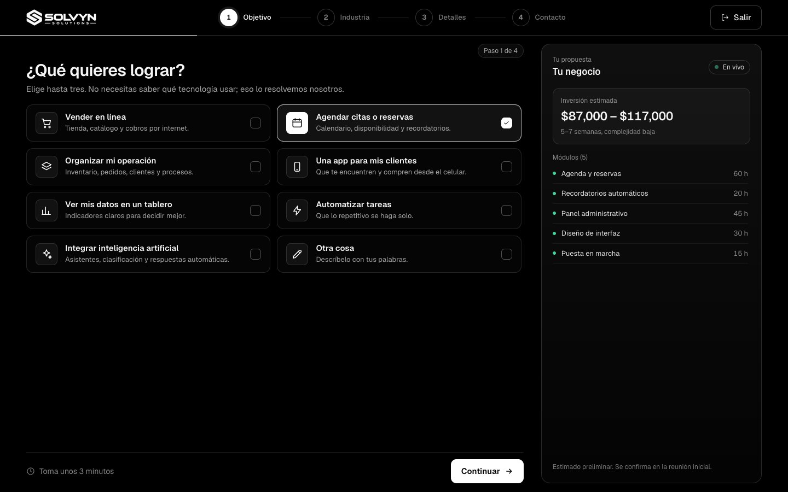       | 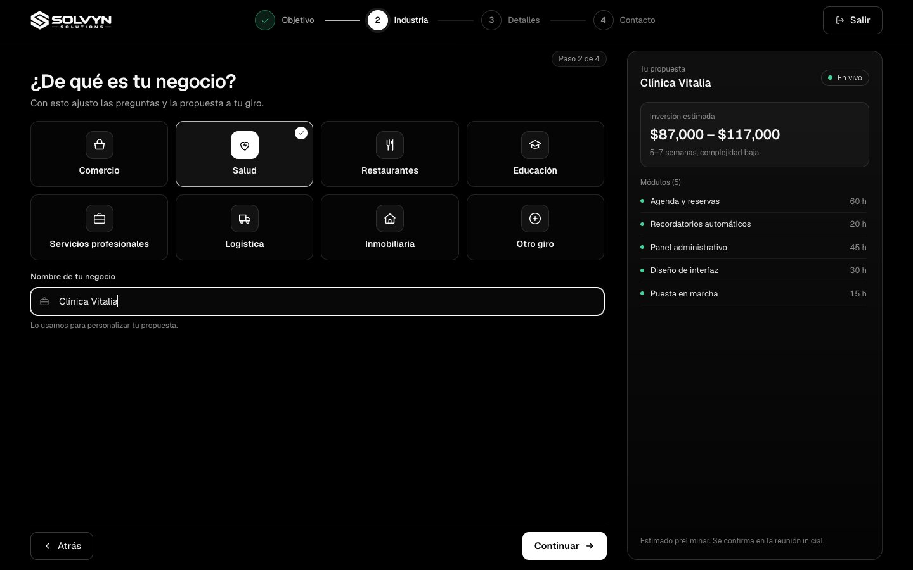 |
| **3. Details**                                               | **4. Contact**                                                 |
| 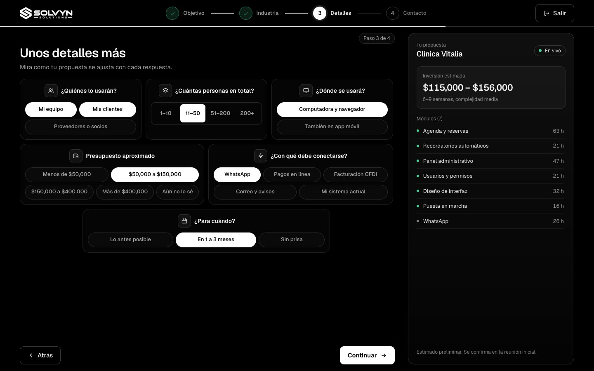 | 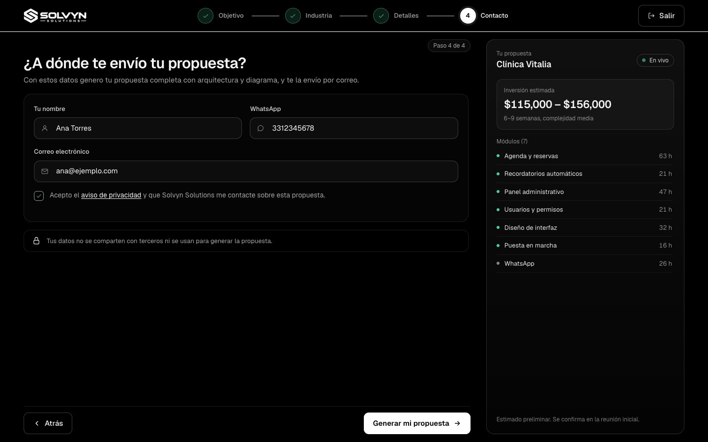   |

Every step fits the viewport without page scroll on laptop-size screens, and the live proposal panel stays visible on the right.

### Proposal

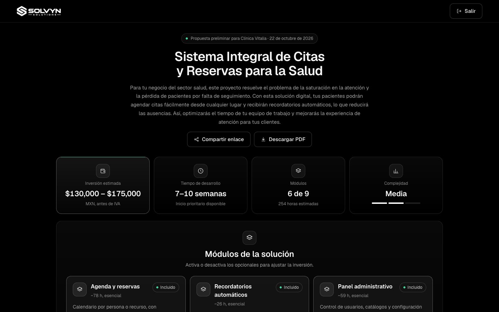

| Interactive architecture                                    | Plain-language system map                               |
| ----------------------------------------------------------- | ------------------------------------------------------- |
| 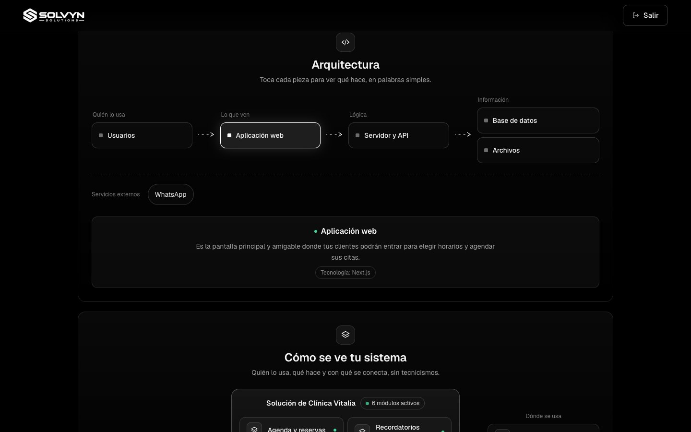 | 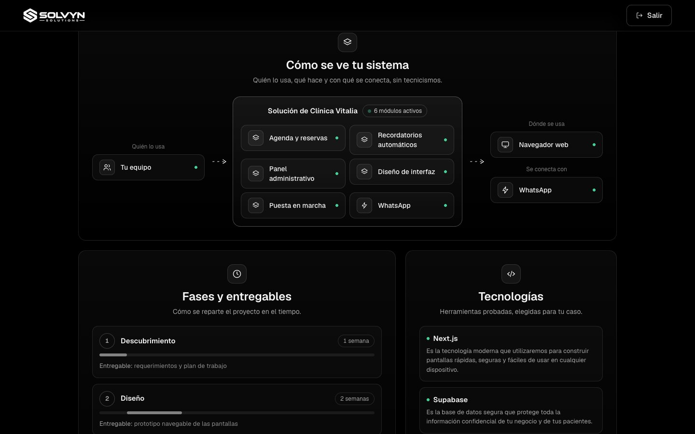 |

### Printable PDF, scheduling and admin access

| Invoice-style PDF                         | Scheduling                                     |
| ----------------------------------------- | ---------------------------------------------- |
| 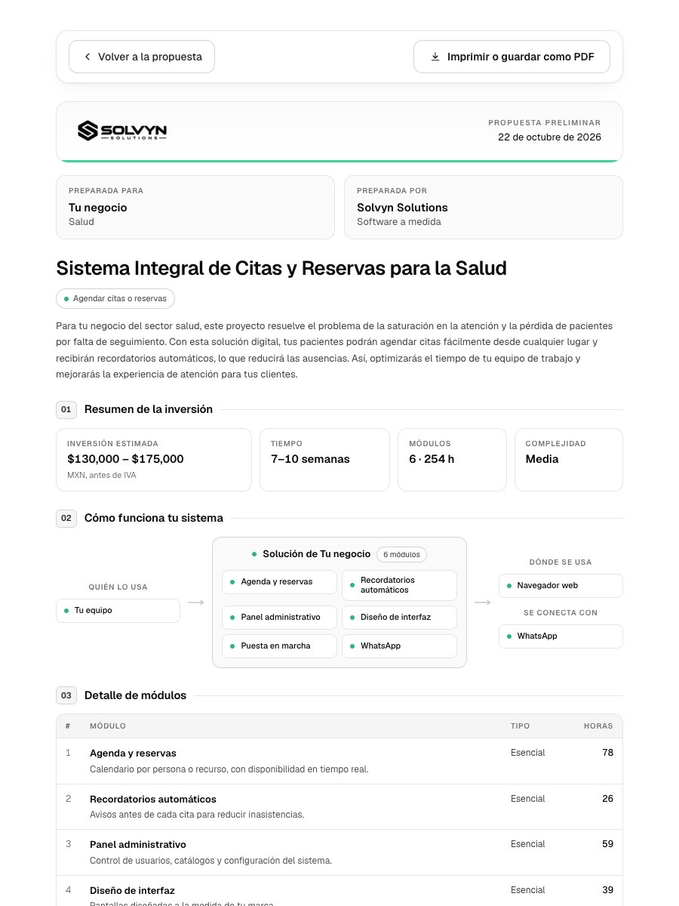 | 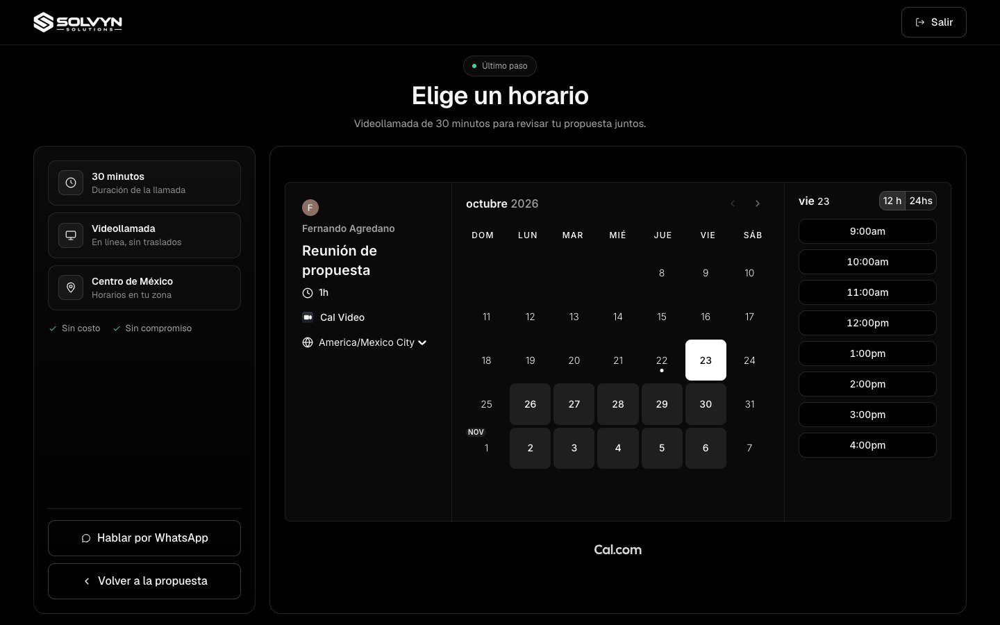 |

| Pricing section                                  | Admin login (magic link)                         |
| ------------------------------------------------ | ------------------------------------------------ |
| 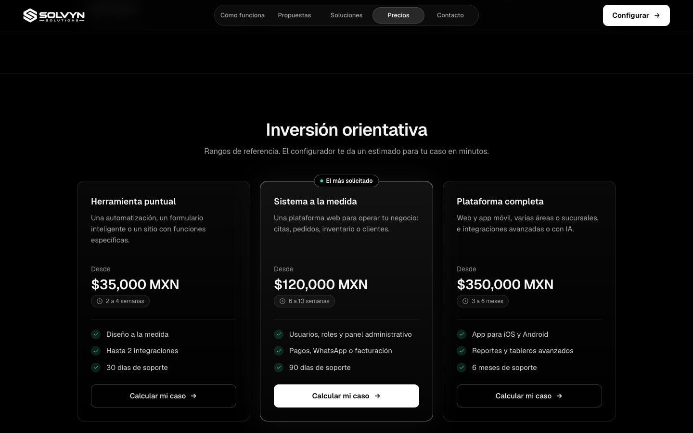 | 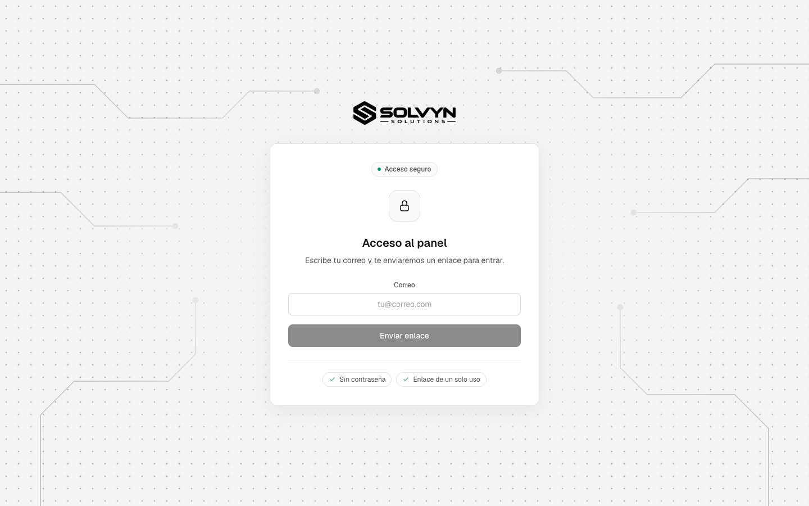 |

### Mobile

| Landing                                                | Proposal                                                 |
| ------------------------------------------------------ | -------------------------------------------------------- |
| 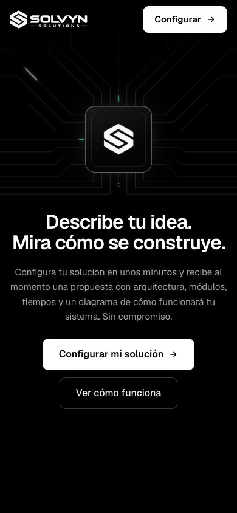 | 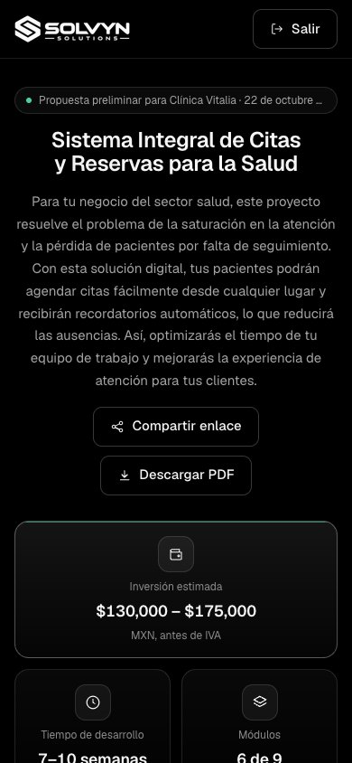 |

> The admin dashboard, leads and settings screens sit behind a magic-link login, so they are not part of the screenshots.

## How the flow works

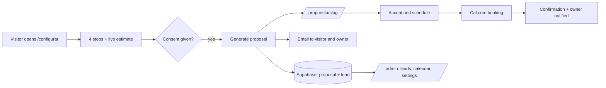

1. **Questionnaire.** Answers live in a Zustand store. Everything except personal data is persisted in `localStorage`, so a reload does not lose progress. Contact data and consent are kept in memory only: consent must be given in the current session.
2. **Generation.** The server builds the proposal facts (modules, hours, prices) from deterministic rules, then asks an AI model only for the wording. If every provider fails, a rules-based draft is used, so the visitor never sees an error.
3. **Sharing.** Each proposal gets a long, unguessable slug and is marked `noindex`.
4. **Acceptance.** Accepting marks the lead; booking a meeting stores the date and notifies the owner. If the contact data was lost (for example after a reload), the visitor is sent back to the contact step with an explanation and returns to the scheduling screen afterwards.

## Architecture and key decisions

**Pattern: Next.js full-stack (App Router).** The project is a single web client with its own server logic, no mobile app and no need to scale a backend independently, so a separate API would add deployment and typing overhead without a benefit. Route handlers (`/api/proposal`, `/api/lead`, `/api/meeting`) and Server Actions cover the server side. If a mobile client ever appears, the domain logic in `src/lib/` is framework-agnostic and can move behind a standalone API.

Decisions worth calling out:

- **Prices never come from the AI.** Modules, hours, investment and timeline are computed in `src/lib/pricing.ts` and `src/lib/proposal.ts`. The model can only choose among modules that exist in the catalog and writes the copy, validated with Zod.
- **One AI layer.** No component calls a provider directly; everything goes through `src/lib/ai/`.
- **Cache Components.** The app uses `cacheComponents` with Partial Prerendering: static shells, request-time data behind `Suspense`.
- **Two visual themes.** The public site is a dark, black-and-white UI where green is reserved for "ok/active" indicators; the admin panel is a light zinc theme. Geist is used across both.
- **Accessibility.** Visible focus states, 44 px touch targets, `prefers-reduced-motion` support, native `<dialog>` for modals, and content that never depends on an animation to be visible.
- **Privacy by design.** No cookies or trackers on the public site; the funnel analytics stub only logs to the console in development.

## Pricing rules

All figures come from `src/config/pricing.ts` and `src/lib/pricing.ts`.

- **Hourly rate:** 600 MXN by default, editable from the admin panel.
- **Hours** = sum of active modules × team-size multiplier (1–10: ×1, 11–50: ×1.05, 51–200: ×1.15, 200+: ×1.3).
- **Investment** = from `hours × rate × 0.85` to `hours × rate × 1.15`, rounded to the thousand.
- **Weeks:** minimum `max(2, floor(hours × 0.9 / 30))`, maximum `max(min + 1, ceil(hours × 1.1 / 30))`.
- **Complexity:** under 220 h low, under 420 h medium, above that high.
- **Phases:** discovery 10%, design 20%, development 55%, testing and launch 15%.

## AI layer

```
Gemini (free tier)  ──fails──▶  OpenRouter (free model)  ──fails──▶  Rules-only draft
```

- Model names live in environment variables, not in code.
- Responses are validated with Zod; unexpected fields (such as a price) are rejected.
- **Only the project description is sent to the model.** Name, email and phone are never sent, and emails, phone numbers and links are stripped from the description first.
- Every generated proposal is stored and reused for identical answers, and generations are rate-limited per hashed IP and hashed email (3 per 24 hours).

## Security and privacy

- **Row Level Security** on every table with contact data. The admin reads with the signed-in user's session, never with the service role; ESLint fails the build if admin code imports the service-role client.
- **Passwordless admin.** Magic link restricted to a single `ADMIN_EMAIL`, with a confirmation page that does not consume the token when mail scanners open the link, and `Origin`/`Sec-Fetch-Site` checks on every Server Action. Details in [`docs/admin-security.md`](docs/admin-security.md).
- **Privacy notice and consent.** Consent is recorded with its date and the notice version before any personal data is stored (LFPDPPP). IPs and emails are stored only as salted HMAC hashes for rate limiting.
- **Headers and indexing.** `/admin` is `noindex`, `no-store` and cannot be framed; shared proposals are `noindex`.
- **Secrets** live only in `.env.local` and the hosting provider's variables. `.env.local` is git-ignored.

## Tech stack

| Layer             | Choice                                                                              |
| ----------------- | ----------------------------------------------------------------------------------- |
| Framework         | Next.js 16 (App Router, Cache Components, Turbopack), React 19, TypeScript (strict) |
| Styling           | Tailwind CSS v4, Geist via `next/font`                                              |
| State             | Zustand with `persist`                                                              |
| Database and auth | Supabase (PostgreSQL, RLS, magic-link auth)                                         |
| AI                | Vercel AI SDK with Google Gemini and an OpenAI-compatible fallback (OpenRouter)     |
| Email             | Resend                                                                              |
| Scheduling        | Cal.com embed                                                                       |
| Validation        | Zod                                                                                 |
| Tests             | Vitest                                                                              |
| CI                | GitHub Actions                                                                      |

## Project structure

```
src/
  app/            Routes: landing, /configurar, /propuesta, /admin, /api, legal pages
  components/     configurator, proposal (incl. print), scheduling, admin, sections, ui
  config/         Catalog, pricing, plans, industries, site data (single source of truth)
  hooks/          Restore, flow guard, live proposal, proposal generation
  lib/            Pricing, proposal engine, AI layer, email, leads, settings, Supabase clients
supabase/
  migrations/     001 proposals, 002 leads, 003 admin RLS, 004 settings
  templates/      Magic-link email template
  tests/          RLS tests
docs/             Admin security notes and screenshots
design/           Approved design references
```

## Running it locally

**Requirements:** Node.js 20.9 or newer, and a Supabase project.

```bash
git clone <repo-url>
cd solvyn-web
npm install
cp .env.example .env.local   # then fill in the values
npm run dev                  # http://localhost:3000
```

**Database.** Run the SQL files in `supabase/migrations/` in order (`001` to `004`) from the Supabase SQL editor. To use the admin panel, add your address to `ADMIN_EMAIL`, create the user in Supabase Auth and register it in the `admin_users` table (see [`docs/admin-security.md`](docs/admin-security.md)). In Supabase, set the Site URL and redirect URLs to your site, and paste `supabase/templates/magic-link.html` into the Magic Link email template.

Only the three Supabase keys and `HASH_SALT` are required. Without AI keys the proposal is generated by rules; without email keys nothing is sent; without a Cal.com link the scheduling screen offers WhatsApp and email.

## Environment variables

| Variable                                                    | Required    | Purpose                                          |
| ----------------------------------------------------------- | ----------- | ------------------------------------------------ |
| `NEXT_PUBLIC_SUPABASE_URL`, `NEXT_PUBLIC_SUPABASE_ANON_KEY` | yes         | Supabase client                                  |
| `SUPABASE_SERVICE_ROLE_KEY`                                 | yes         | Server-only access for public routes             |
| `HASH_SALT`                                                 | yes         | Salt (16+ characters) for hashing IPs and emails |
| `NEXT_PUBLIC_SITE_URL`                                      | recommended | Public URL; inlined at build time                |
| `GEMINI_API_KEY`, `GEMINI_MODEL`                            | optional    | Primary AI provider                              |
| `OPENROUTER_API_KEY`, `OPENROUTER_MODEL`                    | optional    | AI fallback                                      |
| `RESEND_API_KEY`, `OWNER_EMAIL`, `EMAIL_FROM`               | optional    | Transactional email (all three or none)          |
| `ADMIN_EMAIL`                                               | for admin   | The only address allowed into `/admin`           |
| `NEXT_PUBLIC_CAL_LINK`                                      | optional    | Cal.com event, `username/event-slug`             |

## Scripts, tests and CI

```bash
npm run dev      # development server
npm run build    # production build
npm run lint     # ESLint
npm test         # Vitest (178 tests)
```

Tests focus on the flows where a bug costs money or data: pricing and the proposal engine, the AI layer (provider fallback, schema rejection, anonymization), rate limits, lead scoring, the admin session and RLS, and email templates. A GitHub Actions workflow (`.github/workflows/ci.yml`) runs lint, tests and build on every push and pull request to `main`.

## Deployment

Designed for **Vercel**:

1. Import the repository and add the environment variables above.
2. Set `NEXT_PUBLIC_SITE_URL` to the deployed URL and redeploy (it is inlined at build time).
3. In Supabase, set the Site URL and add the deployed URL to the redirect URLs.
4. For real clients, verify a domain in Resend and change `EMAIL_FROM`; Resend's test sender only delivers to the account owner.

## Status and roadmap

**Done:** landing, configurator, proposal generation with fallbacks, shareable proposals, PDF export, scheduling and confirmation, admin panel (dashboard, leads, calendar, settings), transactional emails, RLS and admin security tests, responsive layouts.

**Pending before a public launch:**

- Legal review of the privacy notice and terms (they are drafts).
- A verified email domain (see [Deployment](#deployment)).
- Clearing the saved answers after the confirmation screen.
- Real analytics (`track()` is a local stub); update the privacy notice and its version when connected.
- The visual solution preview was paused in favor of the system diagram; its components remain in `src/components/proposal/preview/`.

---

Built by **Fernando Yael Agredano Parada** as a portfolio project.
